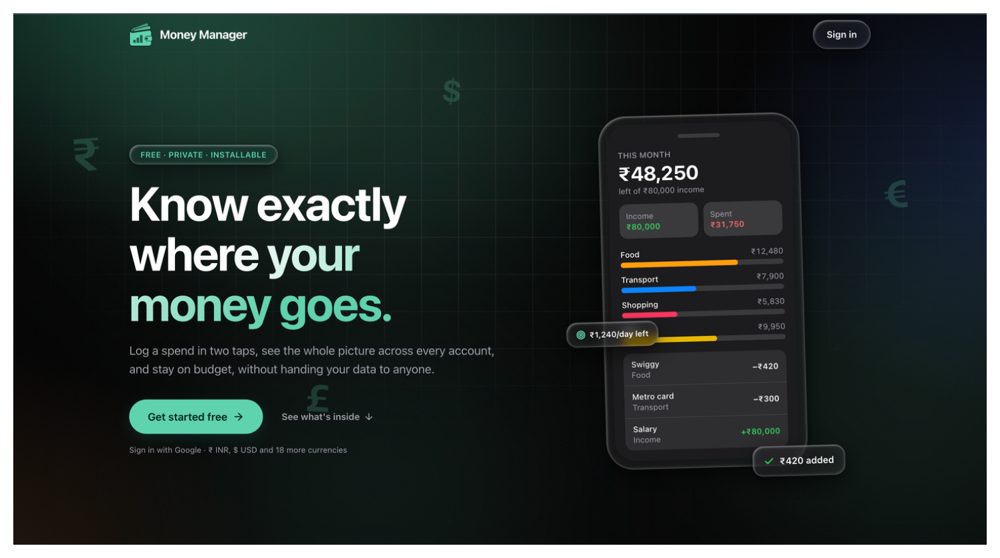

# 💰 Money Manager

**Money Manager** is a mobile-first personal finance tracker built as an installable PWA with Next.js and MongoDB.

It lets you log income and expenses, manage accounts and categories, set monthly budgets, and understand your spending through charts, with backups you control.

---

## 🔗 Live Demo

* [moneymanager.rahultech.in](https://moneymanager.rahultech.in)

---

## 📸 Preview



---

## 📖 Overview

Money Manager helps you:

* Record transactions across multiple accounts
* Organize spending with custom categories
* Plan and track monthly budgets
* Review trends with per-period stats and charts
* Keep your data safe with Google Drive or local file backups

Sign-in is Google only. Backups can be stored privately in your own Google Drive app data folder, or exported as a file.

---

## ✨ Features

* 🔐 Google Sign-In (Better Auth)
* 💸 Transactions: add, edit, delete and restore, with receipt attachments
* 🏦 Accounts & Categories Management, with balance rebuild
* 🎯 Monthly Budgets, with copy-from-previous-month
* 📊 Stats & Charts by day, week, month and year
* 🔍 Search, Filters and CSV Export
* ☁️ Backup & Restore via Google Drive or a local file
* 🔒 Optional App Lock with passcode
* 🎨 4 Themes (Liquid Glass, Android, Paper, Midnight), each with accent palettes
* 📱 Installable PWA

---

## 🛠 Tech Stack

### Frontend

* React 19 (Next.js 16 App Router, JavaScript)
* Tailwind CSS 4
* Lucide Icons

### Backend

* Next.js Route Handlers
* MongoDB (official driver)
* Better Auth (Google OAuth)
* Google Drive API (`drive.appdata` scope)

---

## ⚙️ Getting Started

```bash
npm install
cp .env.example .env.local
npm run db:indexes
npm run dev
```

### Environment Variables

| Variable | Description |
| --- | --- |
| `MONGODB_URI` | MongoDB connection string |
| `MONGODB_TRANSACTIONS` | `true` if your MongoDB supports transactions (replica set) |
| `BETTER_AUTH_SECRET` | Secret used to sign sessions |
| `BETTER_AUTH_URL` | Public base URL, e.g. `http://localhost:3000` |
| `GOOGLE_CLIENT_ID` | Google OAuth client ID |
| `GOOGLE_CLIENT_SECRET` | Google OAuth client secret |

---

## 👨‍💻 Author

[**Rahul Dutta**](https://www.linkedin.com/in/irahuldutta02)

---
